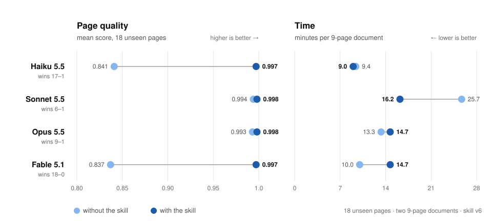
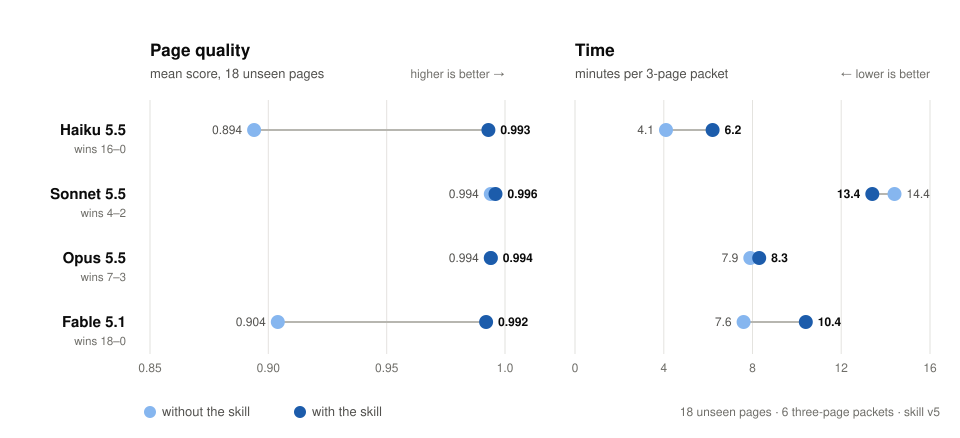

<p align="center">
  
</p>

<h1 align="center">scan-to-vector</h1>

<p align="center">
  <b>Rebuild scanned books, manuals, worksheets and charts as searchable PDFs with vector diagrams, checked page by page against the scan.</b><br>
  An agent skill for Claude Code, Codex and any client that reads <code>SKILL.md</code>.
</p>

<p align="center">
  English · <a href="README.zh-CN.md">简体中文</a>
</p>

<p align="center">
  
  
  
  
  <a href="https://github.com/3351666087/scan-to-vector-skill/actions/workflows/tests.yml"></a>
  <a href="LICENSE"></a>
</p>

---

OCR gives you a scan with invisible text on top. **scan-to-vector gives you the page rebuilt**: real text you can search and copy, diagrams and charts redrawn as vector paths that stay sharp at any zoom, photographs and engravings kept as clean, labelled crops. Every source page is tracked in a ledger and the rebuild is overlaid on the scan before it ships.

> **Measured, not claimed:** on two 9-page scanned documents it had never seen, all four models we tested scored higher with this skill. Haiku 5.5 went from 0.841 to 0.997, and Sonnet 5.5 finished 37% faster. [See the benchmark](#does-it-make-agents-better).

## Demos

Both demos are real public-domain scans. The rebuilt PDFs in this repository were produced by an agent following [`SKILL.md`](skills/scan-to-vector/SKILL.md). Every measured coordinate is recorded in a build script, so you can regenerate them yourself.

### Byrne's *Euclid* (1847): text, colour diagrams and an engraved initial

| | Scan (input) | Rebuild (output) |
| --- | --- | --- |
| File | [`scan.jpg`](demo/byrne-euclid-I-11/source/scan.jpg), 1920×2519 JPEG, 300 KB | [`byrne-euclid-I-11.pdf`](demo/byrne-euclid-I-11/rebuilt/byrne-euclid-I-11.pdf), 80 KB |
| Text | pixels | searchable text in an open Caslon (Libre Caslon Text) |
| Diagrams and inline symbols | pixels | 82 vector paths, positions measured on the scan |
| Engraved initial "F" | pixels | kept as a cleaned raster crop, and listed as such |
| Checks | | overlay against the scan, [page ledger](demo/byrne-euclid-I-11/ledger.json), [structural audit](demo/byrne-euclid-I-11/review/audit.json): 0 issues |

Two editorial choices are recorded in the ledger rather than made silently: the long s (ſ) is modernised so that *straight* and *shall* stay searchable, and ∴ and ⊥ are drawn because the text face has no glyphs for them.

### Playfair's trade chart (1786): chart → data → vector

<p align="center">
  
</p>

The agent calibrated the engraved grid, traced both lines and recovered **81 yearly values per series** into [`data.csv`](demo/playfair-1786/rebuilt/data.csv). The [rebuilt chart](demo/playfair-1786/rebuilt/playfair-1786.pdf) is drawn only from that file, and its curves land back on the engraving, crossing in 1754 as the original does. The PDF contains no raster images.

## Does it make agents better?

Yes, and we measured it with four models. Each got the same short request ("recreate these scanned pages as one clean PDF…") twice, once on its own and once with this skill. The documents were ones the skill had never been tuned on: worksheets, tables, charts, flowcharts, forms and two-column articles in hard mode, with unfamiliar typefaces, dense pages, and half of them phone photos taken at an angle with shadows and a desk in the frame. Every page is scored against its ground truth for text, layout, figures and vector share (1.0 is perfect).

**Long documents (skill v6): two 9-page documents, 18 pages, 16 runs**

<p align="center">
  
</p>

| Model | Score without → with | 95% CI of the gain | Pages better–worse | Worst page | Minutes per 9 pages | Tokens per 9 pages |
| --- | --- | --- | --- | --- | --- | --- |
| Haiku 5.5 | 0.841 → **0.997** | +0.089 to +0.228 | 17–1 | 0.558 → 0.989 | 9.4 → 9.0 | 239k → 258k |
| Fable 5.1 | 0.837 → **0.997** | +0.118 to +0.207 | 18–0 | 0.631 → 0.989 | 10.0 → 14.7 | 172k → 251k |
| Sonnet 5.5 | 0.994 → **0.998** | +0.001 to +0.008 | 6–1 | 0.970 → 0.990 | 25.7 → 16.2 | 370k → 320k |
| Opus 5.5 | 0.993 → **0.998** | +0.002 to +0.007 | 9–1 | 0.982 → 0.989 | 13.3 → 14.7 | 244k → 283k |

**Short packets (skill v5): six 3-page packets, 18 pages, 48 runs**

<p align="center">
  
</p>

| Model | Score without → with | 95% CI of the gain | Pages better–worse | Worst page | Minutes per 3 pages | Tokens per 3 pages |
| --- | --- | --- | --- | --- | --- | --- |
| Haiku 5.5 | 0.894 → **0.993** | +0.050 to +0.160 | 16–0 | 0.634 → 0.952 | 4.1 → 6.2 | 133k → 180k |
| Fable 5.1 | 0.904 → **0.992** | +0.050 to +0.133 | 18–0 | 0.711 → 0.951 | 7.6 → 10.4 | 124k → 187k |
| Sonnet 5.5 | 0.994 → 0.996 | −0.003 to +0.007 | 4–2 | 0.953 → 0.972 | 14.4 → 13.4 | 215k → 235k |
| Opus 5.5 | 0.994 → 0.994 | −0.005 to +0.006 | 7–3 | 0.985 → 0.951 | 7.9 → 8.3 | 155k → 188k |

- **On long documents every model did better with the skill**, and for all four the 95% confidence interval of the gain is above zero.
- **Cheaper models catch up.** On their own, Haiku and Fable lose their grip over a long document: pages come out stretched, tables drift and diagrams lose shapes, with worst pages of 0.56 and 0.63. With the skill both score 0.997, level with Sonnet and Opus.
- **Strong models get faster and steadier.** Sonnet finished the 9-page documents 37% faster with fewer tokens, and the worst pages of both Sonnet and Opus improved. On short 3-page jobs they were already near the ceiling, so the gain there is within noise.
- **The extra minutes are the checking.** Fable and Haiku spend more time with the skill on short jobs, because it makes them proofread and compare before they stop.

The long-document timings come from two documents per model, so treat them as indicative.

### Why it works

Agents fail at this job in predictable ways, and each part of the skill targets one of them.

- **They see a shrunken page.** A vision model reads a downscaled image, so positions, sizes and small digits are guesses. The draft script measures everything in scan pixels, and the doubtful words are shown enlarged on one proofreading sheet per page.
- **They don't notice what they missed.** Every rebuild is overlaid on the scan. The report gives PASS or FIX per page and lists what is still missing or misplaced.
- **They take the shortest path.** So the right path is the short one: one command drafts every page, and fixing a misread word is one line in `fixes.json`.

### How it got here

Each version was measured on pages it had not been tuned on, and its failures shaped the next one.

- v1 (instructions only) made Sonnet faster but no better.
- v3 added the one-command draft. Haiku and Fable improved a lot, but a photo-proportion bug cost Sonnet two pages, which v4 fixed.
- v5 traces every line, arrow and chart series into vectors and adds the proofreading sheet. It produced the short-packet results above.
- v6 fixes what those 48 runs exposed: shadowed photo corners, a skew bug on dark photos, column reading order, gridline weight, and paper size read from square checkboxes. On 18 fresh pages the draft alone, with no agent, scores 0.917 (v4), 0.969 (v5) and 0.989 (v6). The long-document results above use v6.

Raw numbers are in [`bench/results/`](bench/results) and the benchmark code is in [`bench/`](bench).

## Is this the right tool?

| | OCR layer (e.g. OCRmyPDF) | PDF → Markdown (e.g. Marker, MinerU) | **scan-to-vector** |
| --- | --- | --- | --- |
| Output | original scan + hidden text | Markdown / JSON | a newly typeset PDF |
| Page appearance | identical to the scan | layout dropped | clean, close to the source |
| Diagrams and charts | stay raster | extracted as images | redrawn as vectors; chart data recovered |
| Provenance and checks | none | none | page ledger, overlay review, PDF audit |
| Speed | seconds | seconds to minutes | an agent working page by page |

If you only need searchable text on top of the scan, use an OCR layer: it is faster and cheaper. Use scan-to-vector when the page itself should be rebuilt: worksheets to print again, manuals with diagrams, old books, charts whose numbers you want back.

## Install

### Claude Code plugin (recommended)

In a Claude Code session:

```text
/plugin marketplace add 3351666087/scan-to-vector-skill
/plugin install scan-to-vector@scan-to-vector-skill
```

From a shell, the same two steps are `claude plugin marketplace add 3351666087/scan-to-vector-skill` and `claude plugin install scan-to-vector@scan-to-vector-skill`. Update later with `claude plugin update scan-to-vector@scan-to-vector-skill`. Plugin skills are prefixed with the plugin name, so the skill is listed as `scan-to-vector:scan-to-vector`; asking for it in plain language works the same.

### One-line install for Claude Code and Codex

```bash
curl -fsSL https://raw.githubusercontent.com/3351666087/scan-to-vector-skill/main/install.sh | bash
```

[`install.sh`](install.sh) copies the skill into `~/.claude/skills` and/or `~/.codex/skills`, for each agent it finds on the machine. To pick the target yourself, end the command with `| bash -s -- --claude`, `--codex` or `--dir DIR` (the skills folder of any other client). Running it again updates a copy it installed. A copy you have edited is left alone unless you add `--force`, which first moves it to `skill-backups/` next to the skills folder. To read the script before running it, clone the repository and run `./install.sh`.

Use the plugin or a copy in `~/.claude/skills`, not both, or Claude Code lists the skill twice.

### Manual copy

```bash
git clone https://github.com/3351666087/scan-to-vector-skill.git
```

| Agent | Command |
| --- | --- |
| Claude Code | `mkdir -p ~/.claude/skills && cp -R scan-to-vector-skill/skills/scan-to-vector ~/.claude/skills/` |
| Codex | `mkdir -p ~/.codex/skills && cp -R scan-to-vector-skill/skills/scan-to-vector ~/.codex/skills/` |
| Others | copy `skills/scan-to-vector/` into any directory your client loads Agent Skills from |

### Python dependencies

Whichever way you installed the skill, its scripts need Python 3.10+ with PyMuPDF, Pillow, numpy and scipy, plus the `tesseract` command for OCR (`install.sh` prints this reminder when they are missing):

```bash
python3 -m pip install "PyMuPDF>=1.28.2,<2" "Pillow>=12.3.0" "numpy>=1.26" "scipy>=1.11"
brew install tesseract        # or: sudo apt install tesseract-ocr
```

## Use

Ask your agent in plain language:

```text
Use scan-to-vector to rebuild worksheet.pdf as a clean, searchable PDF.
Keep every question and answer blank; redraw the diagrams as vectors, photos can stay.
Check each page against the scan and tell me about missing pages or unreadable spots.
```

```text
Use scan-to-vector to turn this scanned chart into data.csv and a redrawn vector chart.
```

```text
Use scan-to-vector to resume the half-finished rebuild in ./manual:
read the checkpoint and the page ledger, then continue from the first unfinished page.
```

## How it works

1. **Draft every page in one command.** `draft.py` flattens photos, straightens each page and evens out the light. It reads the text twice with Tesseract at double resolution and places every word at its measured position, size and weight, in reading order. Rules, shading, bars and fills are drawn directly. Every other line, arrow, outline and chart series is traced into vector shapes.
2. **Proofread from one sheet per page.** Doubtful words, and any ink not yet drawn, are cropped, enlarged and collected on one image with their ids. The agent corrects readings in `fixes.json` and never guesses unreadable text.
3. **Compare with the scan.** Each rebuild is overlaid on the scan. The report gives PASS or FIX per page with the regions still missing; the agent fixes those and rebuilds.
4. **Keep long jobs resumable.** Books get a page ledger and checkpoints, so the work can continue without the chat history ([`references/long-documents.md`](skills/scan-to-vector/references/long-documents.md)).
5. **Deliver** the PDF with a short note: what is text and vector, what stays raster, what is uncertain.

Details live in [`SKILL.md`](skills/scan-to-vector/SKILL.md) and the [`references/`](skills/scan-to-vector/references) guides.

## Scripts

```bash
S=skills/scan-to-vector/scripts
python $S/draft.py page1.jpg page2.jpg --out work --pdf out/rebuilt.pdf   # draft, compare, report
python $S/draft.py --rebuild work --pdf out/rebuilt.pdf                   # after editing fixes.json
python $S/zoom.py work/p01/deskewed.png 100 200 600 500 --grid 50 --out work/zoom.png
python $S/pdf_tool.py audit out/rebuilt.pdf --out work/audit.json
```

The comparison and the audit find what is missing or broken. They cannot prove that every reading is right, so the skill always pairs them with proofreading against the scan.

## Reproduce the demos

```bash
python3 -m venv .venv
.venv/bin/pip install -r skills/scan-to-vector/requirements.txt -r demo/requirements.txt
.venv/bin/python demo/byrne-euclid-I-11/rebuilt/build.py
.venv/bin/python demo/playfair-1786/rebuilt/digitize.py      # scan -> data.csv
.venv/bin/python demo/playfair-1786/rebuilt/build.py         # data.csv -> PDF
.venv/bin/python assets/build_hero.py && .venv/bin/python assets/build_chart_demo.py
```

The README animations are generated from these same files. The rebuilt pages are embedded with text as outlines so they look the same on every system, while the PDFs keep real text.

## Reproduce the benchmark

```bash
.venv/bin/python bench/generate.py --out data --split test --count 3 --seed 9100 --hard   # 18 pages with ground truth
.venv/bin/python bench/packets.py make --data data/test --size 3 --out packets
# Run your agent on every packet twice, with and without the skill;
# each run writes runs/<arm>/<packet>/out/rebuilt.pdf
.venv/bin/python bench/packets.py score --packets packets --runs runs --arms baseline skill
```

The scorer ([`bench/score.py`](bench/score.py)) aligns each rebuilt page with the truth and combines text F1, layout ink F1, figure ink F1 and vector share.

## Tests

```bash
.venv/bin/python -m unittest discover -s tests -v
```

The tests generate synthetic pages and PDFs on the fly and need no real books. The draft tests need `tesseract` and are skipped without it.

## Limits

- This is a workflow for an agent, not a one-click converter. Rebuilding takes minutes per page and costs model time.
- An audit passing does not mean the content is right; the skill requires review against the source.
- The benchmark is synthetic: printed English pages with a known ground truth. Handwriting, dense engravings and other scripts are harder, and Tesseract reads only English unless you add language packs.
- Retained photographs or engravings make the result a mixed-content PDF, and the delivery note says so.
- Deleting sources or publishing results happens only when you ask. The skill grants no such permission by itself.

If scan-to-vector saved you an afternoon, a ⭐ on the repository helps other people find it.

## Credits

- Oliver Byrne, *The First Six Books of the Elements of Euclid* (1847), scan via [Wikimedia Commons](https://commons.wikimedia.org/wiki/File:First_six_books_of_the_elements_of_Euclid_1847_Byrne.djvu) / [Internet Archive](https://archive.org/details/firstsixbooksofe00byrn), public domain.
- William Playfair, *The Commercial and Political Atlas* (1786), scan via [Wikimedia Commons](https://commons.wikimedia.org/wiki/File:Playfair_TimeSeries-2.png), public domain.
- [Libre Caslon Text](https://github.com/thundernixon/Libre-Caslon), SIL Open Font License ([`demo/fonts/OFL.txt`](demo/fonts/OFL.txt)).

## License

Code and documentation are released under the [MIT License](LICENSE). The bundled demo scans are in the public domain, and Libre Caslon Text keeps its own SIL Open Font License ([`demo/fonts/OFL.txt`](demo/fonts/OFL.txt)).
